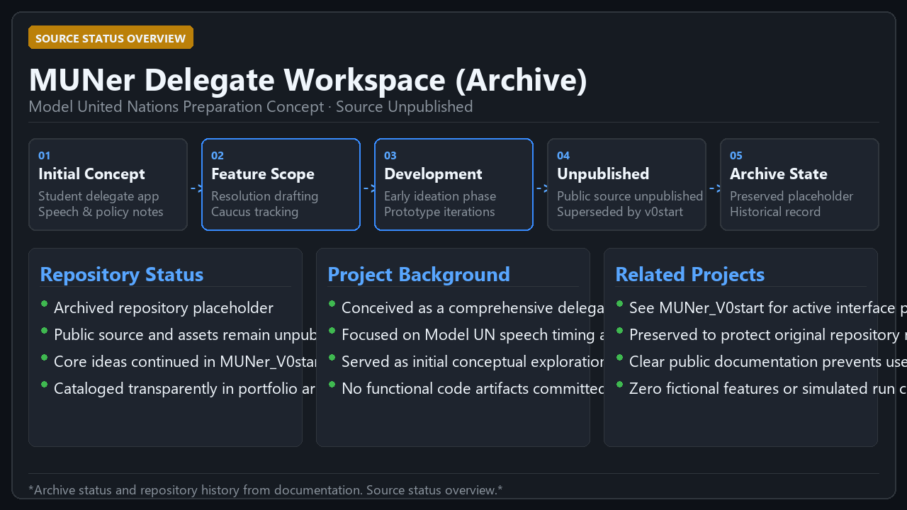

# MUNer

*Click preview above to view source status overview.*

**The public trail stops at the name.** There is no source or supporting asset here to show what MUNer does, so this repository is a status marker rather than a runnable project or a reliable feature demo.
